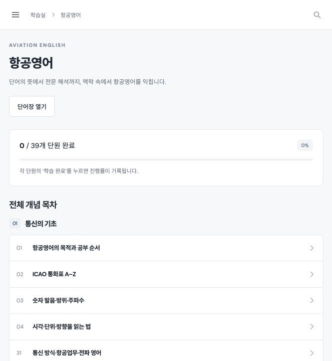

# AERO NOTE · 항공무선통신사 학습실

**[학습 사이트 바로가기 ↗](https://aero-radio-study-20261025.vercel.app)**

전파법규와 항공영어의 개념을 읽고 CBT로 확인하며, 수신·송신 실기를 연습하는 웹사이트입니다. 흰색 중심의 CBT 화면으로 PC와 모바일에서 사용할 수 있습니다.



*항공영어 학습 화면 · 2026년 11월 2일 캡처*

## 주요 기능

- **[그림 개념 이해](https://aero-radio-study-20261025.vercel.app/#visual-english)**: 생성한 설명 그림 3장과 원본 교육 그림 5장으로 체공·항법·지상 이동·LAHSO·후류를 학습. 한국어 상황 예시·풀이·그림 확대·원본 출처 제공

- **단원별 연습**: 각 법규·영어 단원에서 해당 개념 문제를 바로 풀고 상세 설명으로 이동
- **개념 88단원**: 전파법규 39개, 항공영어 39개, 실기 10개
- **기출 중심 CBT**: 2017–2023년 항공영어 기출 112문항과 현행 법령에 대조한 법규 기출 12문항을 우선 출제. 기출만·개념만·전체 섞기 선택 가능
- **한 문제씩 채점·해설**: 답 선택 → 이 문제 채점 → 해설 보기. 원본 PDF 쪽수와 관련 개념 연결, 답안 자동 저장, 최종 제출 때 기록·오답 반영
- **일반영어 상식 제외**: 기존 일반 문법·독립 어휘 10문항은 새 CBT에서 제외하고 항공 문장 해석으로 단원을 개편. [기출 수록 내역](docs/past-exam-import.md) · [CBT 사용 안내](docs/cbt-practice.md)
- **법령 원문**: 관련 법령 5종, 본문 671개 조문, 공식 표와 별표 연결
- **영어 단어장**: 200개 용어와 예문 검색
- **실기 연습실**: A–D 음원, 받아쓰기 비교, 송신 타이머, 음성통화표, 로컬 녹음
- **학습 관리**: 완료 표시, 북마크, 메모, 학습 기록 내보내기·불러오기

## 실행 및 검증

별도 라이브러리를 설치하지 않는 HTML·CSS·JavaScript 사이트입니다. 자료 생성과 검증에는 Node.js 20 이상을 사용합니다.

```bash
npm run build
npm test
python3 -m http.server 4173 --directory dist
```

[로컬 학습실](http://localhost:4173)을 열면 됩니다. 서버 없이 `dist/index.html`을 열어도 기본 학습 기능을 사용할 수 있지만, 녹음 등 브라우저 권한 기능은 실행 환경에 따라 제한될 수 있습니다.

## 파일 구성

```text
dist/                 웹 화면과 배포용 파일
  assets/             기출·실기 자료, 법령 표·별표
  app.js              학습 화면 및 브라우저 기능
  concept-practice.js  단원별 개념 연습문제
  visual-english.js    그림으로 이해하는 항공영어
  style.css           반응형 흰색 CBT 스타일
  data.js             content에서 생성한 학습 자료
content/              과목별 개념·문항·출처와 법령 본문
scripts/              학습 자료 생성 및 검증
vercel.json           Vercel 배포 설정
CONTRIBUTING.md        커밋·브랜치 및 병합 규칙
```

개념·문항을 수정할 때는 `content/`의 JSON을 수정하고 `npm run build`를 실행합니다. `dist/data.js`는 직접 수정하지 않습니다. 그림 개념 자료는 `content/visual-english.json`, 화면은 `dist/app.js`, 개념 연습은 `dist/concept-practice.js`, 스타일은 `dist/style.css`에서 수정합니다.

## 배포 및 개발 흐름

현재 사이트는 Vercel의 `aero-radio-study-20261025` 프로젝트에 배포되어 있습니다. 이 저장소의 배포 디렉터리는 `dist`이며, 배포 전 자료 생성과 검증을 실행합니다. GitHub에 push하는 것만으로 자동 배포되지는 않으며 별도의 Vercel Git 연결이 필요합니다.

`main`은 출시 브랜치, `develop`은 개발 통합 브랜치입니다. 작업 브랜치에서 변경한 뒤 `develop`을 먼저 병합해 충돌을 확인하고, `develop`을 대상으로 PR을 만듭니다. 상세 규칙은 [CONTRIBUTING.md](CONTRIBUTING.md)를 따릅니다.

## 자료 기준 및 저장 방식

- 법령 수록본 확인 기준일은 **2026년 10월 25일**입니다. 기출 문제·답안과 KCA 항공영어 범위는 **2026년 11월 4일** 추가 확인했습니다. 법령은 자동 갱신되지 않으며 사이트 내 출처·시행일과 공식 원문을 함께 확인할 수 있습니다.
- 이 사이트의 필기 학습 범위는 **전파법규·영어**입니다. 다른 과목의 면제 여부는 본인의 접수 내역에서 확인해야 합니다.
- 사용자 제공 기출 편집본에서 선별한 문제와 자체 작성 개념 확인 문제를 구분해 표시합니다. 기출에는 회차·번호·문제와 답안 PDF 쪽수를 표시하며, 비공개 실제 CBT 문제은행 전체를 의미하지 않습니다.
- 실기 답안 비교는 연습용 문자 비교로 공식 시험의 채점 방식과 다릅니다.
- 학습 기록은 브라우저와 사이트 주소별로 저장됩니다. 기기나 주소를 옮길 때는 백업 내보내기·불러오기를 이용하세요. 녹음은 서버로 전송하지 않습니다.
- 기출·음원·법령 자료의 출처는 사이트의 **자료 · 개정 확인**에 표시되어 있습니다. 원본 자료의 권리는 각각의 권리자에게 있습니다.
